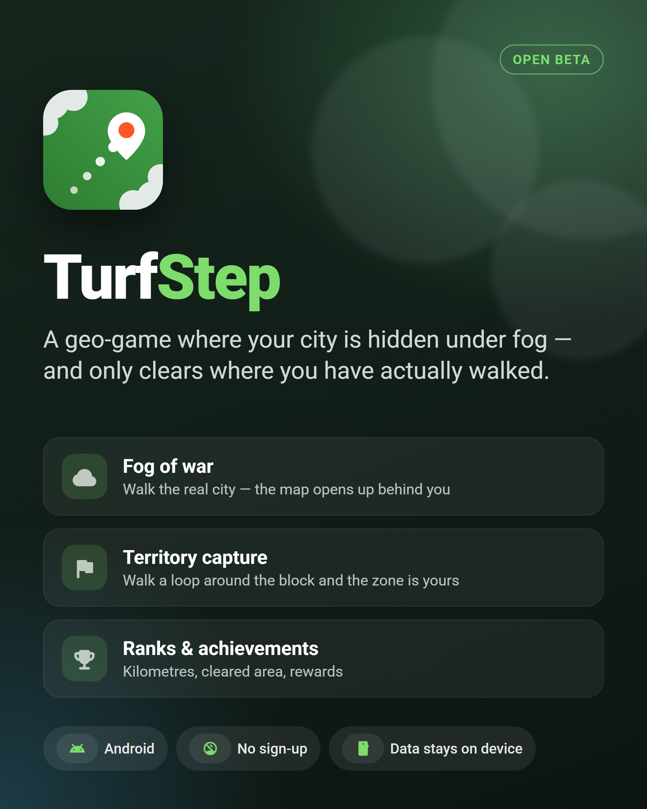
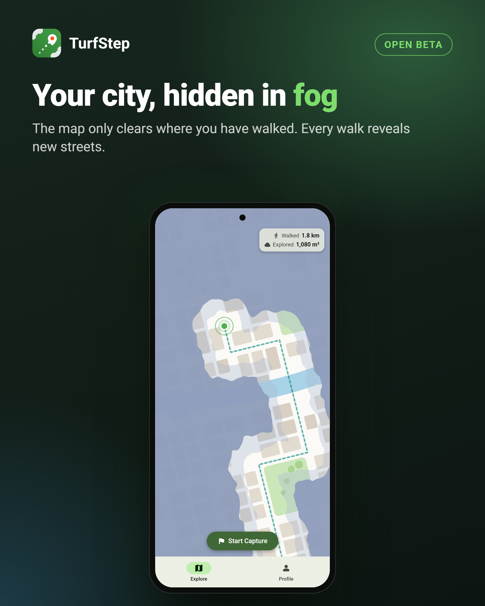
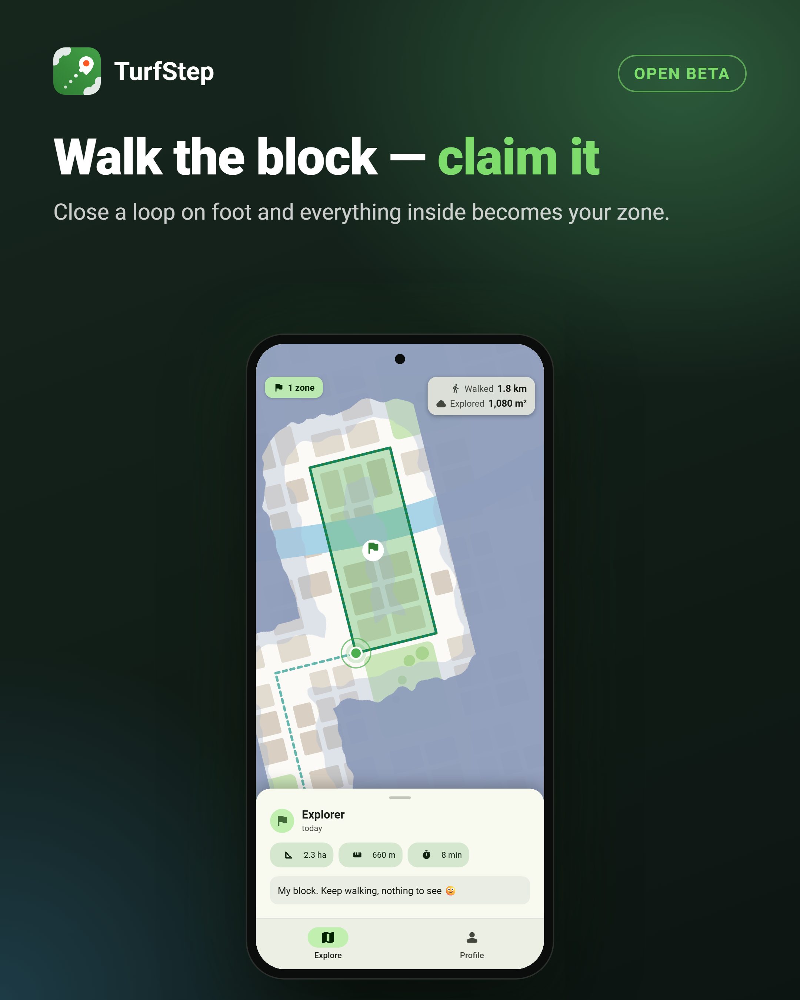
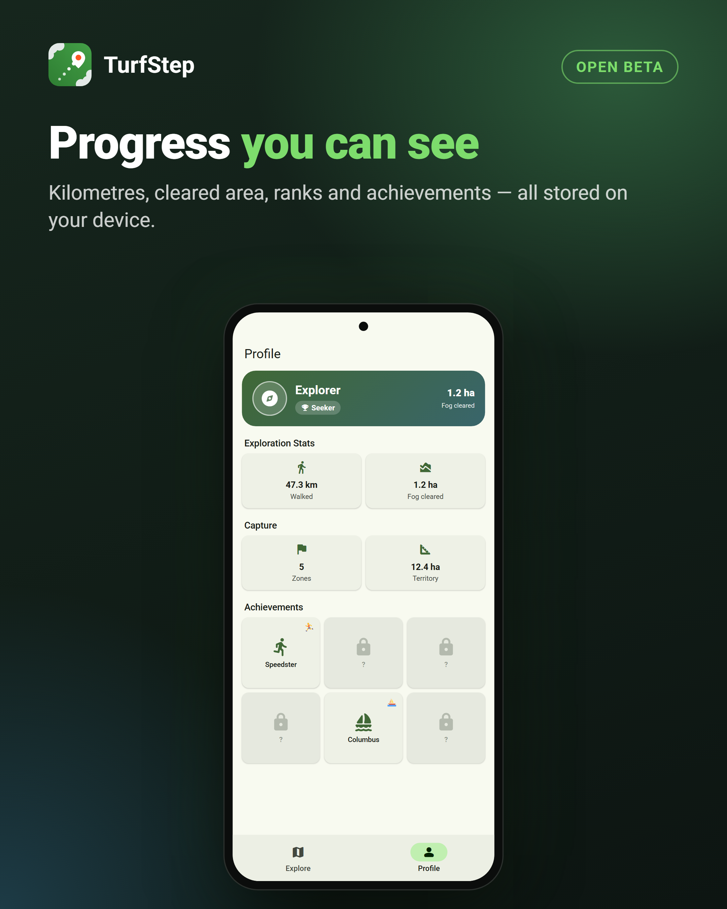

# TurfStep

**A geo-game where your city starts hidden under fog — and only clears where you have actually walked.**

TurfStep is an Android app in **open beta**. Walk around in real life to uncover the map, close a loop on foot to claim the area inside it, and watch your explored territory grow.

**[⬇ Download the APK](../../releases/download/v1.4.0-beta/TurfStep-1.4.0-beta-arm64.apk)** · Android 7.0+ · no sign-up

  
  
  
  

Images are illustrations of the app's interface with sample data, not device screenshots.

## What you can do

- **Clear the fog.** The whole map is covered. As you walk, the area around you is revealed and stays revealed between sessions.
- **Capture territory.** Start a capture, walk a closed loop back to your starting point, and the area inside becomes your zone. You can leave a short message on it.
- **Track progress.** Distance walked, fog cleared, zones captured, ranks and achievements.

## What this beta is — and isn't

This build is **single-player and account-free**:

- No registration, no login, no profile on a server.
- Your explored map, zones and stats are stored **only on your device**. Uninstalling the app deletes them.
- The app does not send your location anywhere. The only network traffic is map tiles, loaded from [OpenFreeMap](https://openfreemap.org); an internet connection is needed for the base map to appear.
- Multiplayer features (other players' zones, friends) exist in the codebase but are switched off in this build.

## Install

1. Open the [release page](../../releases/tag/v1.4.0-beta) on your phone and download **`TurfStep-1.4.0-beta-arm64.apk`**. (Use the `arm32` file only for older 32-bit devices.)
2. Open the downloaded file. Android will ask you to allow installing apps from this source — allow it for your browser or file manager.
3. Launch TurfStep and grant the **location** permission ("While using the app") and the **notification** permission.

Because the app is distributed outside Google Play, Play Protect may show a warning for an unrecognised developer.

### Permissions

| Permission | Why |
|---|---|
| Location (while in use) | Reveals the map around you and records capture routes |
| Notifications | Android requires a visible notification while GPS tracking runs with the screen off |
| Internet | Downloads map tiles |

The app never asks for "Allow all the time" background location. Tracking continues with the screen off through a foreground service and stops on its own after about 10 minutes without movement.

## Known limitations

- Android only.
- GPS accuracy indoors and between tall buildings is limited; the app ignores low-accuracy fixes, so the fog may lag behind you there.
- Continuous GPS use drains the battery faster than normal — this is being tuned during the beta.
- Beta software: expect rough edges.

## Feedback

Found a bug or have an idea? Please [open an issue](../../issues). Useful details: phone model, Android version, and what you were doing when it happened.

## Built with

Flutter · MapLibre GL · OpenFreeMap · Riverpod · Drift (SQLite)
